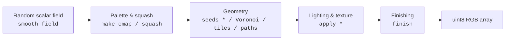

# Architecture

By **Iman Mossavat**, Fontys ICT.

`math_vis` is a small Python toolkit for generating mathematical visuals. It turns
grids of random numbers into smooth fields, assigns geometry and color, applies
lighting and material effects, and finishes the result with grain and vignette.
Everything in the package is built from the same handful of primitives, so the
high-level renderers and the notebooks follow the same pipeline.

## Modules

| Module | What it owns | Main public functions |
|--------|--------------|----------------------|
| `utils` | Palettes, squash, RNG, image helpers | `make_cmap`, `cosine_cmap`, `squash`, `new_rng`, `upfield`, `fig_to_img` |
| `math_tools` | Scalar fields, sampling, geometry primitives | `smooth_field`, `sample`, `seeds_relaxed`, `seeds_spiral`, `seeds_rose`, `lloyd_relaxation`, `arc_points`, `rotate_2d`, `cubic_bezier`, `matchings` |
| `lighting` | Glass lighting, lead lines, texture, cracks | `apply_glass_lighting`, `apply_lead_lines`, `apply_texture`, `apply_bloom`, `apply_streaks`, `apply_cracks`, `apply_rounded_lead`, `lead_mask`, `bevel_rim` |
| `rendering` | Color recipes, glass pipelines, high-level renderers | `cell_colors`, `glass`, `glass_crisp`, `render_flow_field`, `render_truchet_weave`, `render_stained_glass_crisp`, `render_glass_rose`, `parse_tile`, `rotate_tile`, `tile_curve` |
| `basins` | Newton basins of attraction, settling times, and tangledness metrics | `basin_map`, `render_basins`, `uncertainty_exponent`, `fast_lyapunov_indicator`, `basin_entropy` |
| `finishing` | Grain, vignette, save, display | `finish` |

A separate `io` module holds `save_with_meta` and `load_meta` for embedding JSON
generation parameters in PNG assets.

## How the renderers are built

Every `render_*` function takes a seed and returns a `uint8` RGB NumPy array:

* `render_flow_field` builds a smooth field, turns it into angles, integrates
  thousands of starting points with Euler steps, and draws the paths with
  matplotlib.
* `render_truchet_weave` lays down a grid, picks a tile and rotation per cell
  from smooth fields, and draws multi-strand ribbon curves.
* `render_stained_glass_crisp` relaxes random seeds, assigns each cell a color,
  then runs the `glass_crisp` pipeline: streaks, hairline cracks, and rounded
  lead lines.
* `render_glass_rose` builds a radially symmetric seed layout, computes a rose
  color recipe, and runs the soft `glass` renderer (facet, glow, soft lead,
  texture, bloom) before cropping to a circle.

Each renderer ends by calling `finish(...)` to add grain, vignette, and any
requested save/display steps. The notebooks walk through the same stages
interactively.

## Drawing-language prototype

The drawing-language work lives in `notebooks/demo_drawing_language.ipynb`. It
is **not part of the package yet**, but it shows how the primitives can be
wrapped in a small declarative grammar.

What already exists in the notebook:

* Layouts: `Rows` and a warped `Grid`.
* Shapes: `circle`, `halfdisc`, and `quad`.
* The `walk` operator: cumulative random offsets that add memory.
* Named fields and a `field(...)` operator for shared scalar fields.
* `shade`: stacked shrunken copies for soft darkening.
* Isolated random streams per layer / column, so changes stay local.

What is not implemented:

* Additional shapes such as triangle, arc, or line.
* Layouts such as `scatter` or `along_path`.
* Blend modes between layers.
* YAML or JSON round-trip for layer definitions.
* Palette linting or accessibility checks.

## Reproducibility

Passing the same seed to a `render_*` function produces byte-identical output
(verified in `tests/test_reproducibility.py`). All helpers, including
`apply_glass_lighting` and `cell_facet_offset`, accept an explicit `rng`
argument and are reproducible when one is supplied.
