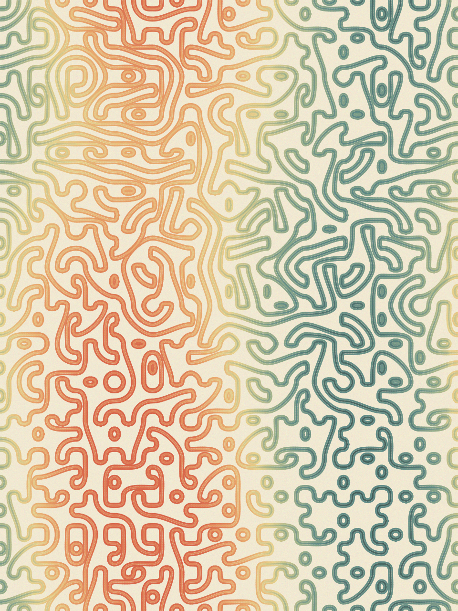
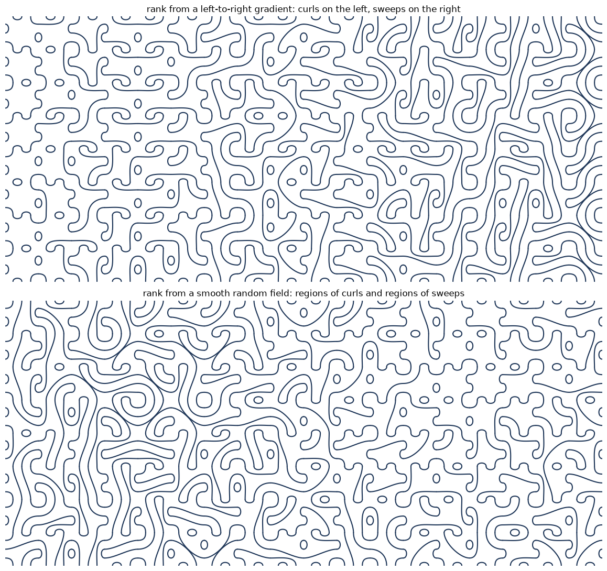

# math_vis

By **Iman Mossavat**, Fontys ICT.

[](https://github.com/imanmossavat/math_vis/actions/workflows/tests.yml)
[](LICENSE)
[](https://www.python.org/)

> Can visual beauty spark mathematical curiosity?

This project explores mathematical ideas by turning them into things we can
generate, see, and experiment with. Using Python, we investigate how simple
rules, randomness, geometry, and transformations produce complex visual
patterns.

The project is a work in progress. It is also an invitation to explore, learn,
experiment, and contribute. You are welcome to use the existing notebooks,
adapt them, or create your own to investigate mathematical ideas that interest
you.

---

## Gallery

A few outputs from the notebooks and renderers.

| Flow field | Glass rose |
|:-----------|:-----------|
|  |  |

| Stained glass (crisp) | Truchet weave |
|:----------------------|:--------------|
|  |  |

| Bezier tiles (multi-strand) | Bezier tiles (field-driven) |
|:----------------------------|:----------------------------|
|  |  |

---

## What's inside?

The repository contains experiments with topics including:

- **Random fields and convolution** — generating noise and exploring how
  Gaussian smoothing creates spatial structure.
- **Voronoi diagrams and tessellations** — partitioning space, exploring
  geometric patterns, and experimenting with Lloyd relaxation.
- **Random walks and stochastic processes** — investigating how repeated random
  movements, drift, and other rules shape patterns.
- **Flow fields and particle trajectories** — exploring how vector fields guide
  movement.
- **Truchet tiles** — creating intricate patterns from simple tile
  arrangements.
- **Symmetry and transformations** — experimenting with rotations, reflections,
  and radial designs.
- **Generative landscapes and stained glass** — combining mathematical processes
  into more elaborate visual compositions.
- **A small drawing language** — declarative layers, isolated random seeds,
  random walks, and shade, showing how one field can play several roles.
- **Basins of attraction and Newton fractals** — fixed points, basins, settling times, uncertainty exponent / entropy metrics, and a float32 precision lesson. Uses the same stained-glass palette as the glass renderers; the two-root control case is red-on-black.

---

## Installation

```bash
git clone https://github.com/imanmossavat/math_vis.git
cd math_vis
pip install -r requirements.txt
```

The package itself is also pip-installable. From the repo root run:

```bash
pip install -e .
```

---

## Quick start

```python
import math_vis as mv

img = mv.render_flow_field(seed=11)
mv.finish(img, display=True)  # show the result; use name=... to save
```

Each `render_*` function already returns a finished `uint8` RGB NumPy array.
Call `mv.finish(...)` again when you want extra vignette, to save, or to display inline.

---

## Start here

| Goal | Notebook | What you will learn |
|------|----------|---------------------|
| Fields, palettes, lighting, and finishing | `demo_lighting_and_sampling.ipynb` | The primitives used everywhere else. |
| Turn a smooth field into flowing lines | `demo_flow_field.ipynb` | Angle fields, numerical integration, and color by starting value. |
| Build patterns from simple tiles | `demo_truchet.ipynb` | Truchet matchings, orientation fields, and multi-strand ribbons. |
| Voronoi cells with crisp lead | `demo_stained_glass_crisp.ipynb` | Lloyd relaxation, cell colors, streaks, cracks, and rounded lead. |
| Radial symmetry and soft glass glow | `demo_glass_rose.ipynb` | Rose-window seed layouts and the facet/glow lighting model. |
| A declarative drawing language | `demo_drawing_language.ipynb` | Layouts, isolated seeds, walks, and reusable layers. |
| Basins of attraction and Newton fractals | `demo_basins.ipynb` | Fixed points, basins, settling times, metrics, and precision. |

---

## Notebooks

The `notebooks/` directory contains the multi-panel demonstrators listed in the
[Start here](#start-here) table above.

### Preview images

When developing new visuals I generate temporary, high-resolution candidate
renders in `notebooks/.preview/`. That folder is git-ignored and local-only, so
it never appears on GitHub. Open the files directly in VS Code or your image
viewer while reviewing.

---

## Documentation

- **[conceptualGuide.md](conceptualGuide.md)** — a conceptual, accessible guide to the mathematics behind the images.
- **[recipes.md](recipes.md)** — implementation recipes, function-specific notes, and detailed descriptions of how the code works.
- **[ARCHITECTURE.md](ARCHITECTURE.md)** — how the package is organized, the data-flow diagram, and reproducibility notes.
- **[CONTRIBUTING.md](CONTRIBUTING.md)** — setup, tests, conventions, and how to add a new piece.

---

## Tests

```bash
pip install -e ".[dev]"
python3 -m pytest -q
```

---

## License

This project is released under the MIT License — see [LICENSE](LICENSE).

---

## Contribute

Ideas, bug reports, and new visual experiments are all welcome. Open an issue
or a pull request on GitHub.

---

## Inspiration

The initial idea for this project came from seeing Kenny Vaden's art work on LinkedIn.
