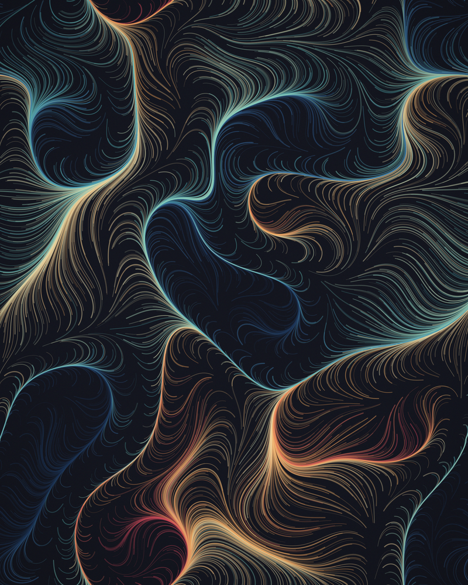
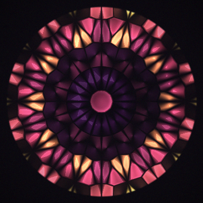
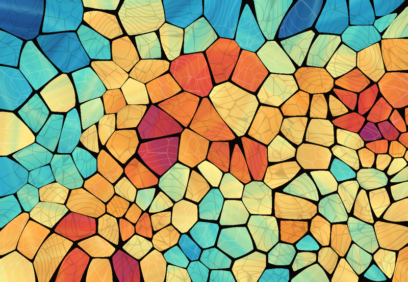
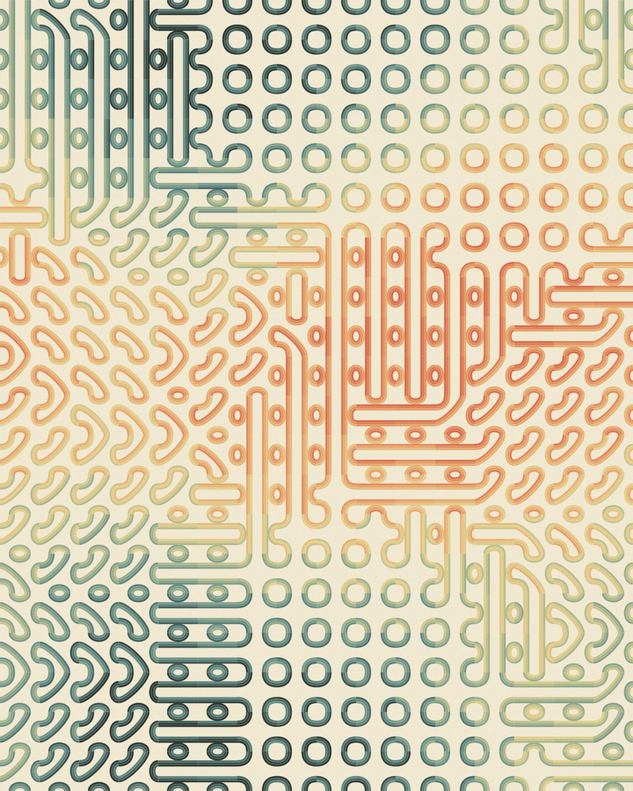
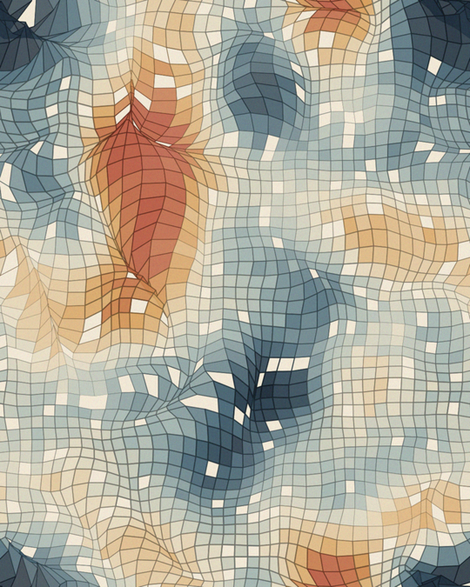
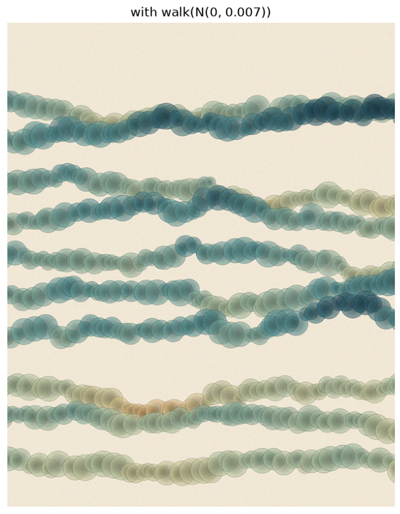

# math_vis

By **Iman Mossavat**, Fontys ICT.

[](https://github.com/imanmossavat/math_vis/actions/workflows/tests.yml)
[](LICENSE)
[](https://imanmossavat.github.io/math_vis/)
[](https://mybinder.org/v2/gh/imanmossavat/math_vis/main?urlpath=tree/notebooks)
[](https://www.python.org/)

> Can visual beauty spark mathematical curiosity?

This project explores mathematical ideas by turning them into things we can
generate, see, and experiment with. Using Python, we investigate how simple
rules, randomness, geometry, and transformations produce complex visual
patterns.

The project is a work in progress. It is also an invitation to explore, learn,
experiment, and contribute. You are welcome to use the existing notebooks,
adapt them, or create your own to investigate mathematical ideas that interest
you.

## Inspiration

The initial idea for this project came from seeing Kenny Vaden's art work on LinkedIn.
If you enjoy these experiments, you should check them out on [LinkedIn](https://www.linkedin.com/search/results/people/?keywords=Kenny%20Vaden).

---

## What's inside?

The repository contains experiments with topics including:

- **Random fields and convolution** — generating noise and exploring how
  Gaussian smoothing creates spatial structure.
- **Voronoi diagrams and tessellations** — partitioning space, exploring
  geometric patterns, and experimenting with Lloyd relaxation.
- **Random walks and stochastic processes** — investigating how repeated random
  movements, drift, and other rules shape patterns.
- **Flow fields and particle trajectories** — exploring how vector fields guide
  movement.
- **Truchet tiles** — creating intricate patterns from simple tile
  arrangements.
- **Symmetry and transformations** — experimenting with rotations, reflections,
  and radial designs.
- **Generative landscapes and stained glass** — combining mathematical processes
  into more elaborate visual compositions.
- **A small drawing language** — declarative layers, isolated random seeds,
  random walks, and shade, showing how one field can play several roles.

---


## Gallery

A few outputs from the notebooks and renderers.

| Flow field | Glass rose |
|:-----------|:-----------|
|  |  |

| Stained glass (crisp) | Truchet weave |
|:----------------------|:--------------|
|  |  |

| Drawing language: warped grid | Drawing language: random walk |
|:------------------------------|:------------------------------|
|  |  |

---

## Installation

```bash
git clone git@github.com:imanmossavat/math_vis.git
cd math_vis
pip install -r requirements.txt
```

---

## Quick start

```python
import math_vis as mv

img = mv.render_flow_field(seed=11)
img = mv.render_glass_rose(seed=9)
```

Each `render_*` function returns a `uint8` RGB NumPy array. Pass it to
`mv.finish(...)` to add grain, vignette, save, and display.

---

## Start here

| Goal | Notebook | What you will learn |
|------|----------|---------------------|
| Fields, palettes, lighting, and finishing | `demo_lighting_and_sampling.ipynb` | The primitives used everywhere else. |
| Turn a smooth field into flowing lines | `demo_flow_field.ipynb` | Angle fields, numerical integration, and color by starting value. |
| Build patterns from simple tiles | `demo_truchet.ipynb` | Truchet matchings, orientation fields, and multi-strand ribbons. |
| Voronoi cells with crisp lead | `demo_stained_glass_crisp.ipynb` | Lloyd relaxation, cell colors, streaks, cracks, and rounded lead. |
| Radial symmetry and soft glass glow | `demo_glass_rose.ipynb` | Rose-window seed layouts and the facet/glow lighting model. |
| A declarative drawing language | `demo_drawing_language.ipynb` | Layouts, isolated seeds, walks, and reusable layers. |

## Notebooks

The `notebooks/` directory contains the multi-panel demonstrators listed in the
[Start here](#start-here) table above.

---

## Documentation

- **[MATH.md](MATH.md)** — a conceptual, accessible guide to the mathematics behind the images.
- **[TECHNICAL.md](TECHNICAL.md)** — implementation recipes, function-specific notes, and detailed descriptions of how the code works.
- **[ARCHITECTURE.md](ARCHITECTURE.md)** — how the package is organized, the data-flow diagram, and reproducibility notes.
- **[CONTRIBUTING.md](CONTRIBUTING.md)** — setup, tests, conventions, and how to add a new piece.

---

## Tests

```bash
python3 -m pytest -q
```

---

## License

This project is released under the MIT License — see [LICENSE](LICENSE).

---

## Contribute

Ideas, bug reports, and new visual experiments are all welcome. Open an issue
or a pull request on GitHub.
